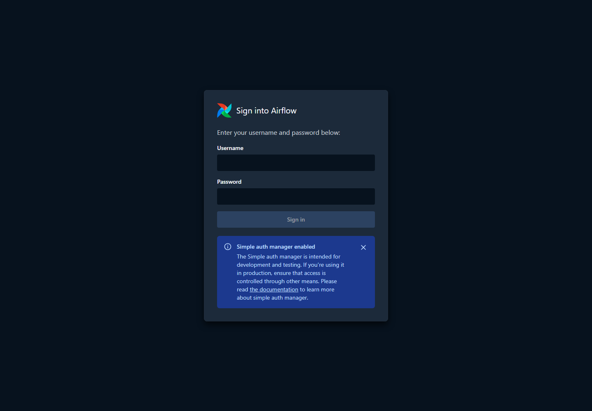

# Airflow setup

## Purpose

Start the same local Airflow workshop on Windows, Linux, or macOS.

## Choose your terminal

| Your OS | Where Airflow runs |
| --- | --- |
| Windows | Ubuntu inside WSL2 |
| Linux | Your Linux terminal |
| macOS | Terminal on your Mac |

Airflow supports Linux and macOS for local development. Windows uses WSL2. See the [official prerequisites](https://airflow.apache.org/docs/apache-airflow/3.3.2/installation/prerequisites.html).

### Windows

If Ubuntu is already installed in WSL2, skip installation. Otherwise, open **PowerShell as Administrator** and run:

```powershell
wsl --install -d Ubuntu-24.04
```

Restart if requested. Open Ubuntu once and finish creating its Linux username and password. These are separate from the Airflow login.

Check that Ubuntu uses WSL version 2:

```powershell
wsl --list --verbose
```

If its version is 1, convert it:

```powershell
wsl --set-version Ubuntu-24.04 2
```

From a PowerShell terminal in the project folder, enter Ubuntu:

```powershell
wsl -d Ubuntu-24.04
```

All remaining commands run **inside Ubuntu**. The Windows notebook environment cannot be reused in WSL. Windows files are accessible under `/mnt/c`.

Reference: [Microsoft WSL installation](https://learn.microsoft.com/en-us/windows/wsl/install).

### Linux

Open your terminal. On Ubuntu 24.04, install the Python environment tools if needed:

```sh
sudo apt update
```

```sh
sudo apt install python3-venv python3-pip
```

On another Linux distribution, use its package manager to install Python and virtual-environment support. The commands above are for Ubuntu, including Ubuntu in WSL.

### macOS

Open Terminal. If needed, install a supported Python version using a [Python macOS installer](https://www.python.org/downloads/macos/). The Ubuntu `apt` commands do not apply to macOS.

## Shared setup: WSL, Linux, and macOS

Use Python **3.12, 3.13, or 3.14** for this workshop. Check your interpreter:

```sh
python3 --version
```

If `python3` selects another version, use your supported interpreter, such as `python3.12`, in the environment creation command below.

Create a separate Airflow environment outside the repository. Skip creation if it already exists:

```sh
python3 -m venv ~/mlops-airflow-workshop/mlops-workshop-env
```

```sh
source ~/mlops-airflow-workshop/mlops-workshop-env/bin/activate
```

Read the environment's Python version so the dependency constraints match it:

```sh
AIRFLOW_PYTHON_VERSION=$(python -c 'import sys; print(f"{sys.version_info.major}.{sys.version_info.minor}")')
```

Install Airflow 3.3.2 with its [official constraints](https://airflow.apache.org/docs/apache-airflow/3.3.2/installation/installing-from-pypi.html):

```sh
python -m pip install "apache-airflow==3.3.2" --constraint "https://raw.githubusercontent.com/apache/airflow/constraints-3.3.2/constraints-${AIRFLOW_PYTHON_VERSION}.txt"
```

```sh
airflow version
```

Expected: `3.3.2`. Skip installation if this version is already available in your Airflow environment.

## Start Airflow: same commands on all three platforms

In your WSL/Linux/macOS terminal, enter the project folder containing `dags/`. Check the current directory:

```sh
pwd
```

Activate the Airflow environment if this is a new terminal:

```sh
source ~/mlops-airflow-workshop/mlops-workshop-env/bin/activate
```

Keep Airflow's generated files outside the repository:

```sh
export AIRFLOW_HOME=~/mlops-airflow-workshop/airflow
```

Point Airflow at this project's DAG folder:

```sh
export AIRFLOW__CORE__DAGS_FOLDER="$(pwd)/dags"
```

Hide bundled example DAGs and scan for workshop files every ten seconds:

```sh
export AIRFLOW__CORE__LOAD_EXAMPLES=False
```

```sh
export AIRFLOW__DAG_PROCESSOR__REFRESH_INTERVAL=10
```

```sh
airflow standalone
```

## Expected result




Leave the terminal running and open [http://localhost:8080](http://localhost:8080) in your normal browser on Windows, Linux, or macOS.

A fresh installation creates the `admin` login and a generated password. If startup does not show it, open a second WSL/Linux/macOS terminal and read:

```sh
cat ~/mlops-airflow-workshop/airflow/simple_auth_manager_passwords.json.generated
```

With the project files present, `iris_model_selection` appears with the `workshop-main` tag. The separate examples have the `workshop-demo` tag. See the [DAG guide](03-airflow-dag.md) and [meeting walkthrough](04-airflow-demo.md).

## Important notes

The Airflow environment and runtime files live under your home directory. Airflow creates its own local SQLite database for orchestration state; this is separate from MLflow's experiment database.

Reuse an already running workshop instance instead of starting a second one. Ctrl+C stops a foreground instance. Repeat activation and the exports in each new terminal. The main notebook workflow also needs `requirements-airflow.txt` and its registered kernel. Follow [the project setup steps](08-main-project.md) before triggering that DAG.

The current runtime and task were tested on Ubuntu 24.04 under WSL2. Native Linux and macOS instructions follow Airflow's supported setup, but have not been executed on separate machines here.
