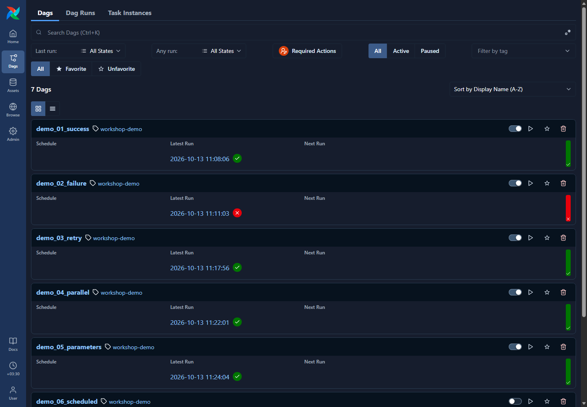

# Define a DAG and use the Airflow UI

## Purpose

Understand how Python defines a workflow, how Airflow starts its tasks, and where results appear. Begin with `demo_01_success`; the [main project](08-main-project.md) uses the same concepts to execute notebooks.

## Definition versus execution

- A **DAG** is the workflow definition: tasks and their dependencies.
- A **task** is one job in that definition.
- A **DAG run** is one execution of the workflow.
- A **task instance** is one task inside that particular run.

Airflow reads `.py` files under `dags/`. The file defines jobs; visiting its UI page does not execute them.

## Read the simple example

Open [success.py](../dags/demos/success.py). This is its current code:

```python
"""Meeting example 1: two tasks finish successfully in order."""

from datetime import datetime, timezone
from time import sleep

from airflow.sdk import dag, task


@dag(
    dag_id="demo_01_success",
    schedule=None,
    start_date=datetime(2025, 1, 1, tzinfo=timezone.utc),
    catchup=False,
    is_paused_upon_creation=True,
    tags=["workshop-demo"],
)
def success_demo():
    @task(retries=0)
    def first_task():
        print("First task is running.")
        sleep(3)  # Give students time to notice the Running state.
        print("First task finished.")

    @task(retries=0)
    def second_task():
        print("Second task starts after the first succeeds.")
        sleep(3)
        print("Second task finished.")

    # The arrow sets the execution order.
    first_task() >> second_task()


success_demo()
```

`@dag` makes the outer function a workflow definition. `dag_id` is its name in the UI. `schedule=None` means manual triggering. `catchup=False` prevents historical scheduled runs.

`@task` turns each inner function into an Airflow-managed job. Calling it while constructing the DAG creates a task node. `first_task() >> second_task()` makes the second wait for the first to succeed. The bottom `success_demo()` call creates the workflow definition for discovery.

During a run, Airflow executes the function bodies. Normal completion becomes Success; an unhandled exception becomes Failed. Print output appears in Logs.

## Find the workflow

1. Open [Airflow](http://localhost:8080) and log in.
2. Select **Dags** in the left navigation.
3. Clear filters if needed; paused workflows are included in **All**.
4. Open `demo_01_success`. Use `workshop-demo` to filter examples or `workshop-main` to find the project.



## Main UI controls

| View/control | What it shows |
| --- | --- |
| Code | The Python definition Airflow read |
| Graph icon | Task boxes and dependency arrows |
| Grid icon | Task states across runs |
| Runs | Execution history; choose the run you want to inspect |
| Task Instances | States, start/end times, attempts, and durations for a run |
| Logs, after selecting a task | Messages and errors from that task's execution |
| Trigger | Start a new manual run |
| Pause toggle | Enable or pause scheduling for the workflow |

Graph and Grid are icon buttons near the top of the task panel in this Airflow version. Hover to see **Show Graph** or **Show Grid**. Open a specific run to see its states; the definition alone does not represent a new execution.

## Run the example yourself

Unpause `demo_01_success`, select **Trigger**, then open its newest run. Watch first_task run and succeed before second_task starts. Select each task and open Logs.


Look for `First task finished.` and `Second task starts after the first succeeds.`. Stop and explain the order before continuing to [the other examples](04-airflow-demo.md).

## Main project

The project has five notebook tasks. They are separate boxes because each notebook execution is an Airflow task. Use [guide 08](08-main-project.md) to understand the runner and the notebook inputs.


## Important notes

Do not use VS Code's ordinary Run Python File action to execute DAG tasks. Use Airflow's Trigger control. Running a notebook manually in VS Code does not create an Airflow task instance.

Screenshots show this workshop's real local UI. Run IDs, dates, versions, and colors can differ on another machine. Source notebooks remain unexecuted in Git; executed copies are local output files.
