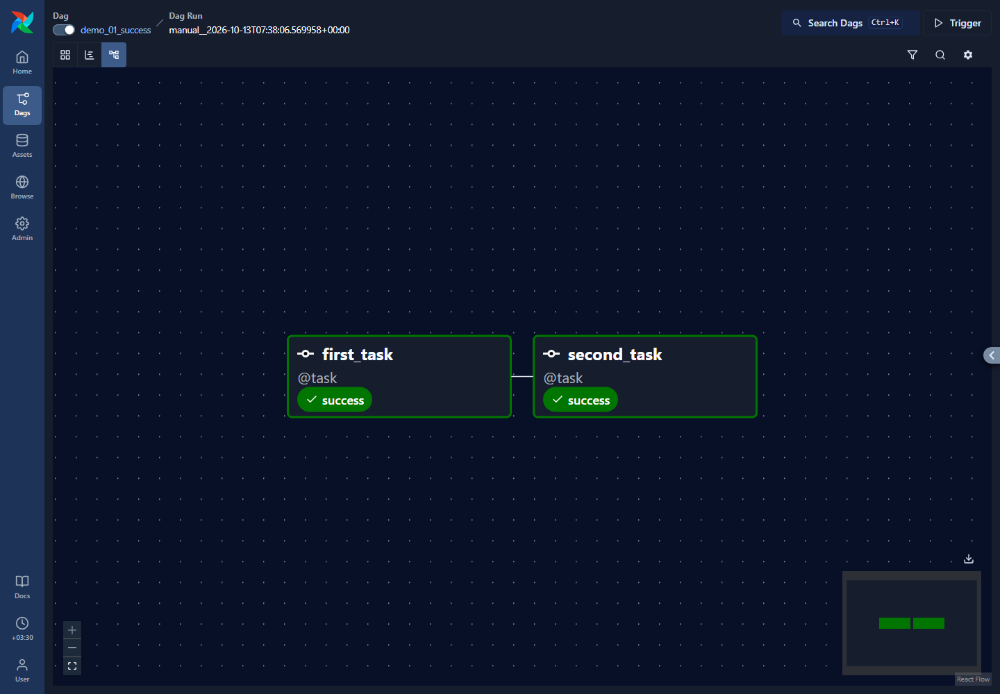
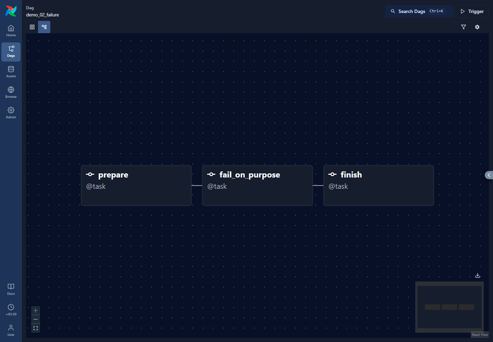
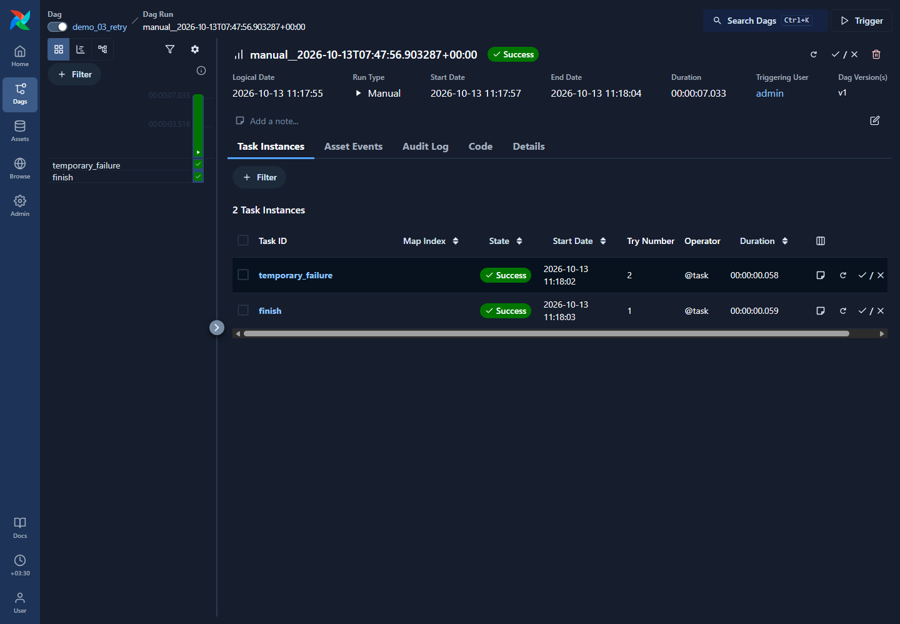
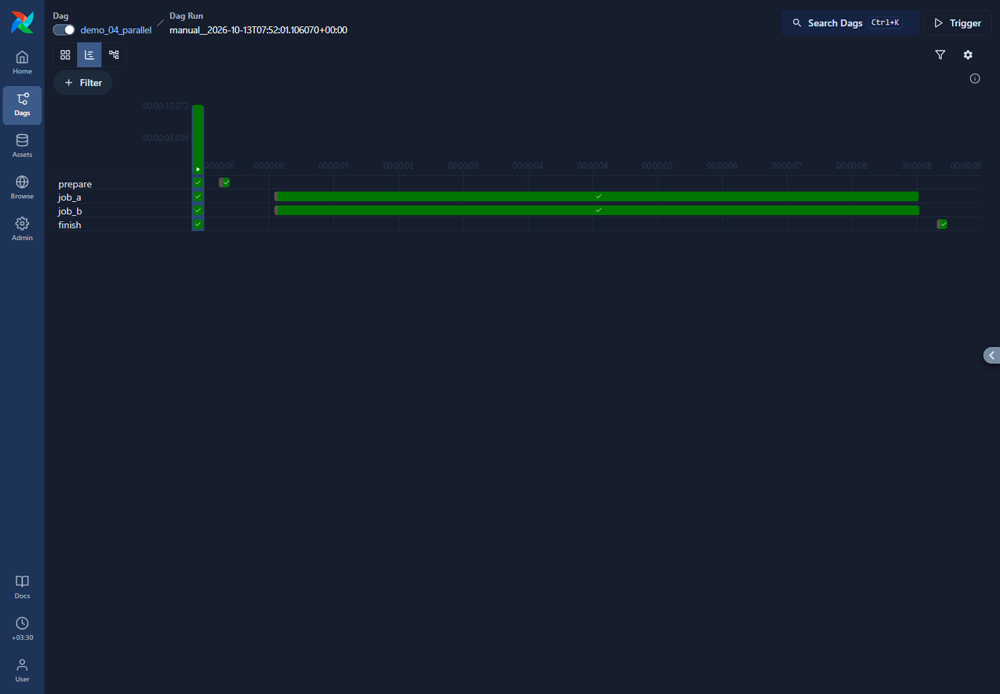
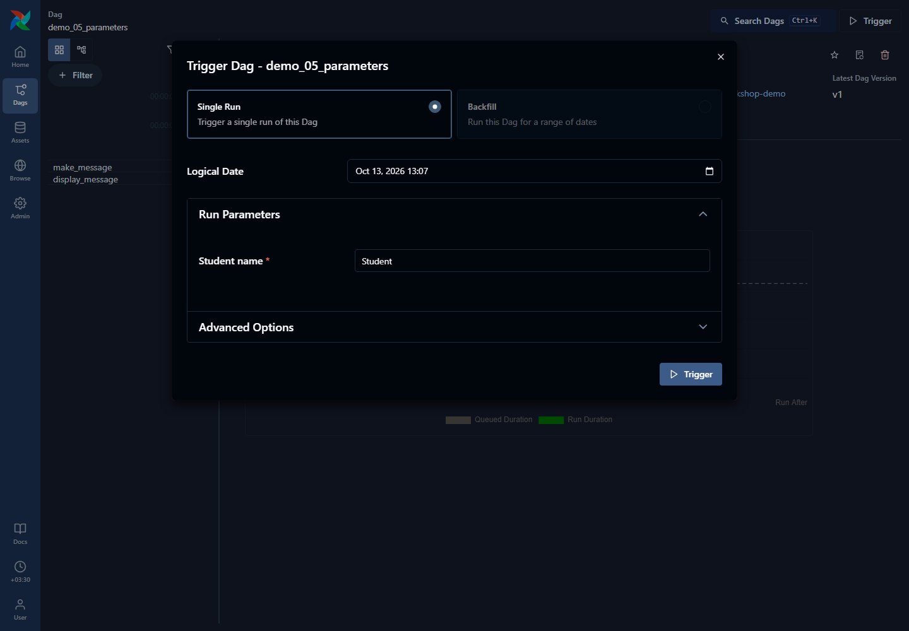
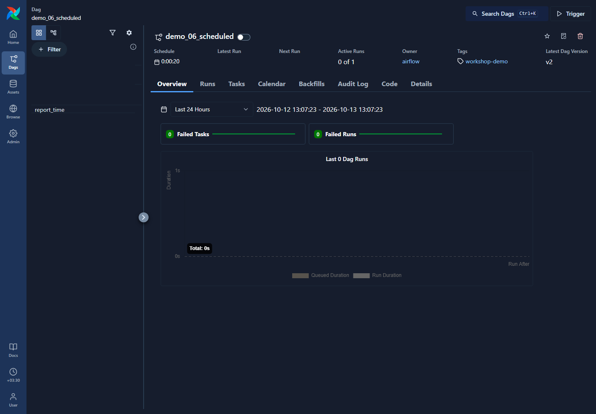

# Airflow meeting examples

## Purpose

Let students run separate examples and compare what Airflow does. Each example is a small, commented Python file under `dags/demos/`. Failures are deliberate and clearly named; the main Iris workflow has no simulated error.

## Prepare the session

Start Airflow using [the setup guide](02-airflow-setup.md). Open [http://localhost:8080](http://localhost:8080), select **Dags**, and filter by the tag `workshop-demo`.

All new example DAGs start paused. Open one example, unpause it, and trigger it manually. For the scheduling example, unpausing enables automatic runs. Leave the other examples paused until needed.

Run the examples yourself during rehearsal: predict the task order, trigger the DAG, observe its states, and read the logs before moving to the next example.

## Example menu

| DAG | Source file | What students should observe |
| --- | --- | --- |
| `demo_01_success` | [success.py](../dags/demos/success.py) | Two tasks succeed in order |
| `demo_02_failure` | [failure.py](../dags/demos/failure.py) | Success, then Failed, then Upstream failed |
| `demo_03_retry` | [retry.py](../dags/demos/retry.py) | First attempt fails, waits to retry, then succeeds |
| `demo_04_parallel` | [parallel.py](../dags/demos/parallel.py) | Two independent jobs can overlap; the last task waits for both |
| `demo_05_parameters` | [parameters.py](../dags/demos/parameters.py) | A name entered in the trigger form becomes a message passed between tasks |
| `demo_06_scheduled` | [scheduled.py](../dags/demos/scheduled.py) | New runs appear automatically after unpausing |
| `iris_model_selection` | [iris_model_selection.py](../dags/project/iris_model_selection.py) | Five notebooks train, compare, register, and verify the selected model |

## Repeat these UI steps for each manual example

1. Open the DAG and inspect **Code**. Read the comments that explain its behavior.
2. Open **Graph** to predict which task will run first.
3. Select **Trigger DAG**, then open the newest entry under **Runs**.
4. Inspect that run's **Graph** or **Grid** as task states change.
5. Select a task and read **Logs**. Compare the message/error to its Python code.

A DAG is a workflow definition; a run is one execution. Always choose the new run rather than inspecting an older result. The short sleeps in the success and parallel samples make Running easier to observe; they simulate work for teaching.

## 1. Success



Trigger `demo_01_success`. `first_task` runs, then `second_task`. Both should become **Success**. The DAG run also becomes **Success**.

## 2. Failure and blocked work



Trigger `demo_02_failure`. `prepare` succeeds. `fail_on_purpose` raises:

```text
ValueError: Intentional workshop failure: this task always fails.
```

That task becomes **Failed**. `finish` becomes **Upstream failed**: its body was never executed because its required predecessor failed. The whole run becomes **Failed**.

This sample always fails on purpose. Rerunning it produces the same outcome. The exact cause is the `raise ValueError(...)` line in its source file. Printing an error message or returning False would not have the same effect.

## 3. Retry



Trigger `demo_03_retry`. Open `temporary_failure` and watch its state become **Up for retry** after its first attempt fails. Its code permits one retry after 5 seconds.

The next attempt prints `Attempt number: 2` and succeeds. The final task then runs. Inspect the first and second log attempts to compare the error and recovery. Scheduling can add a little time to the retry delay.

The failure is controlled by `context["ti"].try_number`: the code raises an error only when the attempt number is 1. A new DAG run starts with a new first attempt, so the demonstration can be repeated.

## 4. Parallel work



Trigger `demo_04_parallel`. After `prepare` succeeds, `job_a` and `job_b` are both eligible to run. They each simulate eight seconds of work. `finish` waits for both to succeed.

Compare task start/end times or the duration view to see overlap. Parallel execution also depends on available executor slots; the graph expresses permission to run independently, rather than guaranteeing simultaneous starts.

## 5. Parameters and task output



Trigger `demo_05_parameters`. Enter a name in **Student name** and confirm. In `display_message` logs, find `Hello, NAME!`.

The trigger form supplies the parameter to `make_message`. That task returns a string; Airflow saves it as an XCom and supplies it to `display_message`. Repeat with a different name and compare the two runs.

## 6. Scheduling



Unpause `demo_06_scheduled` and do not click Trigger. Its schedule is `timedelta(seconds=20)`: a new run becomes eligible every 20 seconds. Airflow's scanning and scheduling can add a delay, so task start times will not necessarily be exactly 20 seconds apart. After changing the file, wait for Airflow to load the new DAG version.

Under **Runs**, identify a run whose type is **scheduled**. Open `report_time` logs to see the execution time. After observing it, pause the DAG again to stop creating additional scheduled runs. An already active run can still finish.

## Connect the examples to the real project

Open `iris_model_selection` afterward. It now executes five project notebooks, including parallel model training and MLflow tracking. Follow [the main project walkthrough](08-main-project.md) to connect these Airflow concepts to the actual model-selection workflow.

## Important notes

Screenshots are real local UI captures. Some show a completed run and others show the definition or trigger form. They do not automatically execute a demonstration on your machine. Select your own newest run when following the exercises.


The demo DAGs are repeatable teaching samples. They do not train or register models. Run the manual examples one at a time, and pause the scheduled example after observing its automatic runs.

Reference: [task states and dependencies](https://airflow.apache.org/docs/apache-airflow/3.3.2/core-concepts/tasks.html), [trigger parameters](https://airflow.apache.org/docs/apache-airflow/3.3.2/core-concepts/params.html), and [UI views](https://airflow.apache.org/docs/apache-airflow/3.3.2/ui.html).
