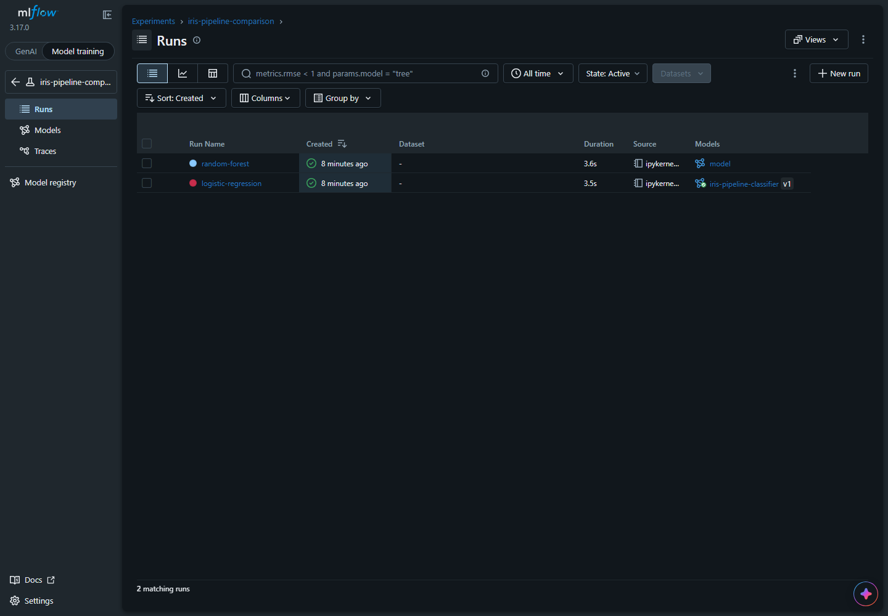

# Open MLflow locally

## Purpose

View the experiment records created by the main project. SQLite stores records in `mlflow.db`; model files live under `mlartifacts/`. MLflow creates the database automatically.

## Start the UI

Run the main Airflow project first using [guide 08](08-main-project.md). In a second terminal at the project root, activate the **Airflow/notebook environment used to execute the pipeline**.

**Windows:** enter Ubuntu WSL first. **Linux/macOS:** use your terminal directly. The following command is the same in those terminals:

```sh
source ~/mlops-airflow-workshop/mlops-workshop-env/bin/activate
```

```sh
python -m mlflow ui --backend-store-uri sqlite:///mlflow.db --host 127.0.0.1 --port 5000
```

Leave that terminal open. Open [http://localhost:5000](http://localhost:5000) in your normal browser. Ctrl+C stops this foreground UI without deleting experiment records.

## Find this project's experiment

1. Select **Model training** at the top of the sidebar if MLflow opens in GenAI mode.
2. Open **Experiments** and choose **iris-pipeline-comparison**.
3. Open **Runs** to see Logistic Regression and Random Forest.



## Expected result

After a complete pipeline run, both training attempts appear with accuracy, model parameters, saved artifacts, and a `workflow_run_id` tag. [Guide 06](06-mlflow-workflow.md) explains what these records mean.

## Important notes

On Windows, start this UI inside WSL for the Airflow project. Its model artifact URIs are Linux paths. Starting a Windows-native UI against those records can display metadata while failing to resolve artifact files. Use the same runtime platform for notebook execution and artifact inspection.

Always launch from the project root so the relative database path matches the notebooks' absolute URI. If the address cannot connect, check that the UI is running and inspect its terminal. If port 5000 is occupied by this project's UI, reuse it.

The optional `notebooks/mlflow/01_mlflow_basics.ipynb` reference uses different experiment/model names. It is not a required preliminary lesson; the main notebooks teach MLflow as they run.
