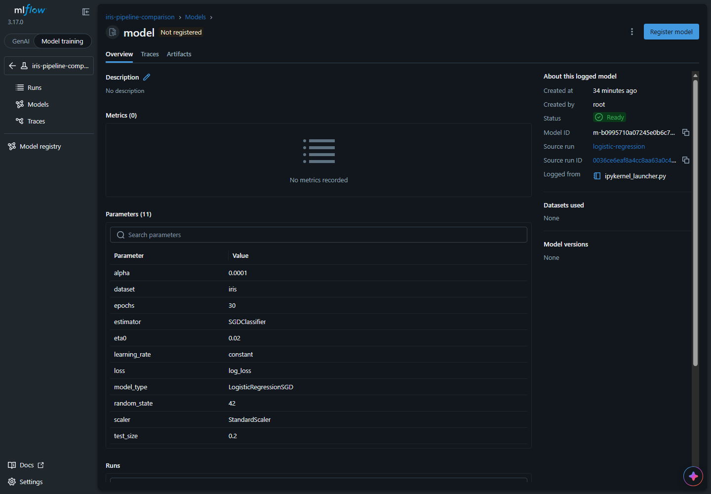

# Explain MLflow through the main project

Use this guide while presenting: show the notebook excerpt, explain what it records, then show the matching MLflow page. These are excerpts from the actual notebooks; run the complete notebooks through Airflow rather than pasting isolated snippets.

## What happens in our project

Airflow starts a notebook task. Scikit-learn trains a model. Our notebook calculates measurements and sends them to MLflow. MLflow saves the records and displays them in its UI. Airflow shows task execution; MLflow shows model results.

| Notebook | Purpose |
| --- | --- |
| [01_load_and_split](../notebooks/01_load_and_split.ipynb) | Shared Iris split and MLflow experiment |
| [02_train_logistic](../notebooks/02_train_logistic.ipynb) | Logistic regression trained with SGD; epoch histories |
| [03_train_random_forest](../notebooks/03_train_random_forest.ipynb) | Random Forest; histories as trees are added |
| [04_compare_models](../notebooks/04_compare_models.ipynb) | Compare final metrics and select the winner |
| [05_register_candidate](../notebooks/05_register_candidate.ipynb) | Register, assign candidate, reload, and trace verification |

## 1. Connect to MLflow and choose an experiment

**Purpose:** store both training approaches in one place so we can compare them.

From the connection cell in notebook 01:

```python
tracking_uri = "sqlite:///" + (project_path / "mlflow.db").as_posix()
mlflow.set_tracking_uri(tracking_uri)
mlflow.set_registry_uri(tracking_uri)
client = MlflowClient()
```

`tracking_uri` points to the project's SQLite database. Tracking stores experiments and runs; the registry stores model versions and aliases. This workshop uses the same database for both. `MlflowClient` lets later notebooks read the saved records.

From notebook 01's experiment cell:

```python
if client.get_experiment_by_name(experiment_name) is None:
    client.create_experiment(
        experiment_name,
        artifact_location=(project_path / "mlartifacts" / "pipeline").as_uri(),
    )

experiment = mlflow.set_experiment(experiment_name)
```

An **experiment** groups related runs. The `if` creates it only when missing. `artifact_location` specifies where saved files and models belong. `set_experiment` selects it for subsequent logging. This data notebook creates no training run.

**In MLflow:** open [MLflow](http://localhost:5000), select Model training if the selector is shown, then Experiments > **iris-pipeline-comparison** > Runs. The screenshot shows the same experiment with two earlier training runs; later executions add rows.


## 2. Open a run and record its settings

**Purpose:** give one training attempt its own record, with settings and a link to the Airflow execution.

From notebook 02, after defining its classifier:

```python
with mlflow.start_run(run_name="logistic-regression") as run:

    # Record the training settings.
    # MLflow parameters explain which configuration produced this run.
    mlflow.log_params({
        "model_type": "LogisticRegressionSGD",
        "estimator": "SGDClassifier",
        "loss": classifier.loss,
        "epochs": epochs,
        "learning_rate": classifier.learning_rate,
        "eta0": classifier.eta0,
        "alpha": classifier.alpha,
        "scaler": "StandardScaler",
        "random_state": split["random_state"],
        "test_size": split["test_size"],
        "dataset": "iris",
    })

    # Link the model run to Airflow.
    # This tag contains the workflow execution ID shown in the Airflow UI.
    mlflow.set_tag("workflow_run_id", split["execution_id"])
    mlflow.set_tag("progress_unit", "epoch")
```

`start_run` opens one MLflow record. The `with` block in the complete notebook contains training, evaluation, and artifact logging. `log_params` records settings such as the learning rate and epoch count. A **tag** is descriptive metadata: `workflow_run_id` connects this record to Airflow, and `progress_unit` explains the metric chart's Step axis.

The Random Forest notebook opens a separate `random-forest` run in the same experiment, with its own settings.

**In MLflow:** click a new **logistic-regression** run. Overview lists latest metrics, parameters, run status, and tags. Look for `epochs=30`, `loss=log_loss`, and `progress_unit=epoch`.


## 3. Log real training progress and view curves

**Purpose:** observe accuracy and loss at real checkpoints, before training finishes.

Notebook 02 constructs logistic regression with SGD:

```python
classifier = SGDClassifier(
    loss="log_loss",
    learning_rate="constant",
    eta0=0.02,
    random_state=split["random_state"],
)
model = make_pipeline(scaler, classifier)
epochs = 30
```

`loss="log_loss"` makes this a logistic regression classifier. The already fitted scaler uses training rows only. `make_pipeline` keeps the scaler and classifier together so the logged model can predict from the original input columns. We chose SGD instead of the earlier `LogisticRegression` estimator to expose one epoch at a time.

The training loop from notebook 02:

```python
for step in range(1, epochs + 1):
    # Train one epoch.
    # partial_fit updates the existing classifier using one pass through the training
    # rows.
    started = perf_counter()
    classifier.partial_fit(X_train_scaled, y_train, classes=[0, 1, 2])
    training_seconds += perf_counter() - started

    # Evaluate the current model.
    # Training and held-out scores show how its predictions change as training
    # progresses.
    train_predictions = model.predict(X_train)
    predictions = model.predict(X_test)
    train_accuracy = accuracy_score(y_train, train_predictions)
    test_accuracy = accuracy_score(y_test, predictions)
    train_probabilities = model.predict_proba(X_train)
    test_probabilities = model.predict_proba(X_test)

    train_log_loss = log_loss(y_train, train_probabilities, labels=model.classes_)
    test_log_loss = log_loss(y_test, test_probabilities, labels=model.classes_)

    # Track this checkpoint.
    # Reusing metric names with a new step lets MLflow build training curves.
    metrics = {
        "train_accuracy": train_accuracy,
        "test_accuracy": test_accuracy,
        "train_log_loss": train_log_loss,
        "test_log_loss": test_log_loss,
        "training_seconds": training_seconds,
        "accuracy": test_accuracy,
    }
    mlflow.log_metrics(metrics, step=step, synchronous=True)
    print(
        f"Step {step}: train_loss={train_log_loss:.4f}, test_loss={test_log_loss:.4f}, "
        f"train_accuracy={train_accuracy:.3f}, test_accuracy={test_accuracy:.3f}",
        flush=True,
    )
```

`partial_fit` performs one pass over the training rows. After each pass, predictions and probabilities produce the metrics. `log_metrics(..., step=step)` saves a **numeric history** in MLflow. `synchronous=True` waits for the write before the next checkpoint. The printed line also appears in Airflow task logs. No curve image is being uploaded here: MLflow draws the charts from those numeric records.

The Random Forest notebook uses a different kind of checkpoint:

```python
for step in range(trees_per_checkpoint, total_trees + 1, trees_per_checkpoint):
    model.set_params(n_estimators=step)
    started = perf_counter()
    model.fit(X_train, y_train)
    training_seconds += perf_counter() - started
```

The model was created with `warm_start=True`, so existing trees remain and each fit adds more. The same evaluation/logging code follows each fit inside that loop. These steps count **trees**, not epochs.

| Model | History points | Meaning of Step |
| --- | --- | --- |
| Logistic regression with SGD | 30 | Epochs 1 through 30 |
| Random Forest | 10 | Total trees: 10, 20, ..., 100 |

| Metric | Meaning | Reading it |
| --- | --- | --- |
| `train_accuracy` | Correct predictions on 120 training rows | Higher is better |
| `test_accuracy` | Correct predictions on 30 held-out rows | Higher is better; selects the winner |
| `train_log_loss` | Probability-based error on training rows | Lower is better |
| `test_log_loss` | Probability-based error on held-out rows | Lower is better |
| `training_seconds` | Cumulative time in fitting calls | Duration, excluding evaluation/logging |
| `accuracy` | Same value as test_accuracy | Existing comparison/registry compatibility key |

Accuracy checks the chosen class. Log loss also accounts for the probability assigned to the true class, penalizing confident wrong predictions. For Random Forest, log loss evaluates predictions; it is not the tree-building criterion. A much better training score than test score can suggest overfitting, although this tiny dataset supports only a teaching demonstration.

**In MLflow:** open the run > **Model metrics**. Inspect train/test accuracy and log-loss charts against Step. Overview shows the latest values; Model metrics shows the full history. Auto-refresh updates charts while a run is active. Iris finishes quickly, but its saved history remains afterward.


Epochs and tree counts are different units. Compare final scores across models rather than treating their steps as equivalent. We repeatedly measure the test split to demonstrate tracking, without tuning settings from those measurements.

## 4. Save evaluation files and the confusion matrix

**Purpose:** keep inspectable outputs beside the numeric metrics.

After the last training step, notebook 02 saves its final evaluation:

```python
mlflow.log_dict({
    **metrics,
    "final_step": step,
    "train_rows": len(y_train),
    "test_rows": len(y_test),
}, "evaluation.json")
```

`log_dict` writes an **artifact**, a saved JSON file. It contains final metric values, the final step, and row counts. The histories already logged under Metrics remain separate.

The same notebook saves a confusion matrix:

```python
# Save the test confusion matrix.
# Rows show actual classes and columns show predictions; off-diagonal counts are
# mistakes.
plot = ConfusionMatrixDisplay.from_predictions(
    y_test,
    predictions,
    labels=model.classes_,
    display_labels=load_iris().target_names,
    cmap="Blues",
    colorbar=False,
)
plot.ax_.set_title("Logistic Regression - test predictions")
plot.figure_.tight_layout()
mlflow.log_figure(plot.figure_, "confusion_matrix.png")
plt.show()
plt.close(plot.figure_)
```

`from_predictions` creates the figure from real test labels and predictions. `log_figure` saves it as an image artifact; `plt.show` displays it in the executed notebook. Rows are actual classes; columns are predicted classes. Diagonal numbers count correct predictions and other cells count mistakes.

**In MLflow:** open the run > **Artifacts** > **confusion_matrix.png**. Select **evaluation.json** in the same file list to inspect final metrics as JSON.


## 5. Log the trained model

**Purpose:** save a usable model, rather than just its scores.

From notebook 02:

```python
model_info = mlflow.sklearn.log_model(
    sk_model=model,
    name="model",
    signature=infer_signature(X_test, predictions),
    input_example=X_train.head(3),
)
```

`sk_model` is the fitted scaler/classifier pipeline. `name` names the logged model. The signature describes expected input and output structure; `input_example` provides three example input rows. `model_info.model_uri` is saved in the notebook's result JSON for comparison and registration. Random Forest also logs its fitted model, with an explicit trusted tree type for serialization.

**In MLflow:** return to the run's **Overview**, then click **model** in Logged models. Overview shows its identity, source run, and parameters. Its **Artifacts** tab contains model files: `MLmodel` describes the signature, and `input_example.json` contains the sample inputs. Logging a model does not yet create a registered version.



This model page can show **No metrics recorded** because our numeric metrics were logged to the training run, rather than explicitly associated with the logged-model ID. Follow **Source run** and open **Model metrics** for the training histories. The model is still saved and reloadable.

## 6. Compare the runs and select the winner

**Purpose:** select using stored results from the two models in the same workflow execution.

After checking matching execution IDs, notebook 04 reads MLflow:

```python
# Read the completed training runs.
# Their metric dictionaries contain the final values stored by MLflow.
logistic_run = client.get_run(logistic_result["run_id"])
forest_run = client.get_run(forest_result["run_id"])
assert logistic_run.info.status == "FINISHED"
assert forest_run.info.status == "FINISHED"
# Build the comparison rows.
# copy keeps the original handoff intact; update adds the model's saved metrics.
logistic_row = logistic_result.copy()
logistic_row.update(logistic_run.data.metrics)

forest_row = forest_result.copy()
forest_row.update(forest_run.data.metrics)

comparison = pd.DataFrame([logistic_row, forest_row])
comparison[[
    "model_type", "train_accuracy", "test_accuracy",
    "train_log_loss", "test_log_loss", "training_seconds",
]]
```

`get_run` retrieves each training record. `FINISHED` checks that both completed. Their metric dictionaries contain the latest checkpoint values, so the table compares final scores.

The winner selection from the same notebook:

```python
winner_index = comparison["test_accuracy"].idxmax()
winner = comparison.loc[winner_index].to_dict()
(run_path / "winner.json").write_text(json.dumps(winner, indent=2), encoding="utf-8")
print("Winner:", winner["model_type"])
print("Accuracy:", winner["accuracy"])
print("Source run:", winner["run_id"])
```

`idxmax` selects the highest final test accuracy. Selection uses the explicitly named `test_accuracy` column. The `accuracy` key remains an identical compatibility value for verification. A tie picks the first row, Logistic Regression. `winner.json` passes the source run and saved model URI to the registration task; it does not retrain the model.

**In MLflow:** return to Runs, tick the two rows with the same `workflow_run_id`, then click **Compare**. Scroll to Metrics to inspect final test accuracy, train/test loss, and duration. Collapsing Visualizations and Parameters makes the results table easier to show. The current completed example has approximately **0.833** test accuracy for SGD logistic regression and **0.900** for Random Forest, so Random Forest wins.


## 7. Register and trace the candidate

Continue with [the registry and tracing guide](07-model-registry.md), which pairs registration, alias assignment, and traced verification code with their UI results.

## Remember when presenting

Parameters are settings. Metrics are numeric measurements and histories. Artifacts are saved files. Registered versions identify saved models. Traces record instrumented execution steps, inputs/outputs, timing, and errors.


Manual notebook execution can record MLflow results but creates no Airflow task instance. Use [the main project walkthrough](08-main-project.md) for integrated execution. Older runs retain their original records; code changes do not update them retroactively.
