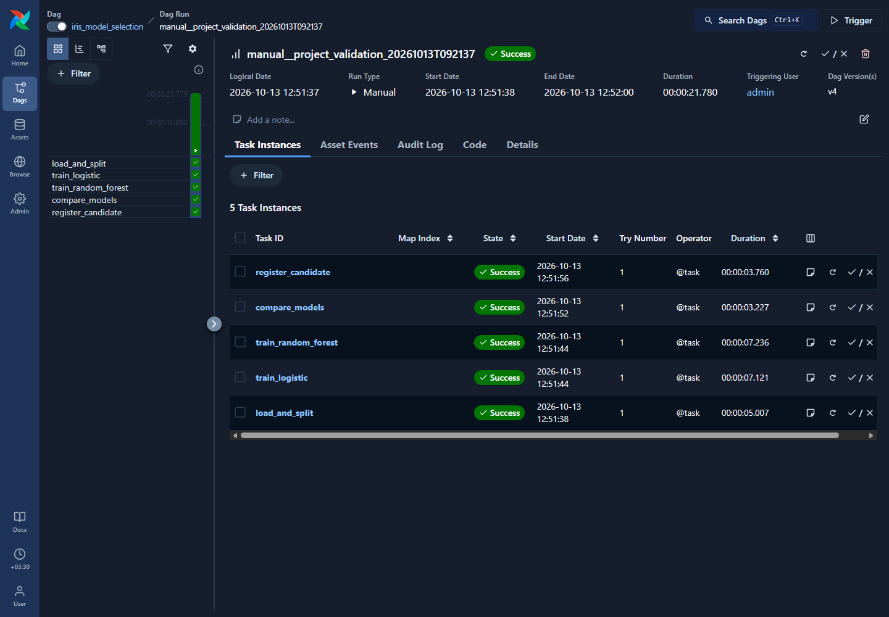
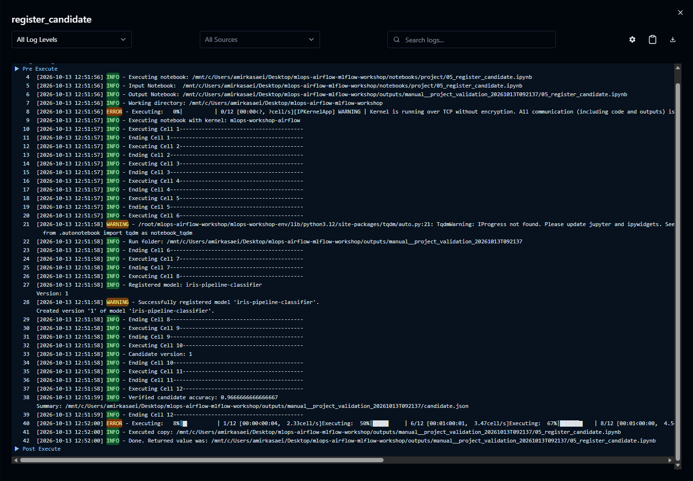

# Run the main notebook project

## Purpose

Let Airflow coordinate five notebook executions while the notebooks train, compare, and register models through MLflow. The separate Airflow demos remain available for feature exercises.

## Files and task order

| Notebook under notebooks/ | Airflow task | Result |
| --- | --- | --- |
| `01_load_and_split.ipynb` | `load_and_split` | `split.json`, 120 training rows and 30 test rows |
| `02_train_logistic.ipynb` | `train_logistic` | MLflow run/model and `logistic_result.json` |
| `03_train_random_forest.ipynb` | `train_random_forest` | MLflow run/model and `forest_result.json` |
| `04_compare_models.ipynb` | `compare_models` | `winner.json` using logged accuracy |
| `05_register_candidate.ipynb` | `register_candidate` | Registered model, alias, traced reload/prediction check, and `candidate.json` |

The DAG definition is [iris_model_selection.py](../dags/project/iris_model_selection.py):

```text
                 load_and_split
                       |
           +-----------+-----------+
           |                       |
     train_logistic        train_random_forest
           |                       |
           +-----------+-----------+
                       |
                 compare_models
                       |
               register_candidate
```


## How the DAG executes notebooks

One small `run_notebook` task function calls Papermill. It is reused with different task IDs and notebook filenames. For example:

```python
train_logistic = run_notebook.override(task_id="train_logistic")("02_train_logistic.ipynb")
```

`.override` gives this use of the runner its own task box. The runner gets the Airflow run ID, creates an output folder, supplies parameters, and executes the notebook with the registered `mlops-workshop-airflow` kernel. The arrows define when each task becomes eligible.

Every notebook has a cell tagged `parameters`. Airflow supplies `project_root`, `run_dir`, and `workflow_run_id`; the other notebook defaults provide experiment/model names. Notebook variables do not carry across kernels. JSON files in that execution's folder pass data and model references between tasks.

## Prepare the execution environment

Complete [Airflow setup](02-airflow-setup.md). Use Ubuntu WSL on Windows, or your normal Linux/macOS terminal. Enter the project root and activate the Airflow environment:

```sh
source ~/mlops-airflow-workshop/mlops-workshop-env/bin/activate
```

Install the main task dependencies while keeping Airflow pinned:

```sh
python -m pip install -r requirements-airflow.txt
```

Register this environment as the notebook kernel used by the DAG:

```sh
python -m ipykernel install --user --name mlops-workshop-airflow --display-name "MLOps workshop Airflow"
```

```sh
python -m pip check
```

Expected: no broken requirements. Register the kernel under the same user that runs Airflow. Start or reuse Airflow with the project DAG folder from guide 02.

## Run from Airflow

1. Open [Airflow](http://localhost:8080) and find **iris_model_selection** under `workshop-main`.
2. Inspect its Code and Graph, then select **Trigger**.
3. Open the new run and watch loading finish, both training tasks run, comparison finish, and registration finish.
4. Select a task and read its Logs. Papermill forwards notebook print output there. The log fullscreen control makes long notebook paths and messages easier to read.
5. Open [MLflow](05-mlflow-setup.md) to inspect the model records.





## Expected result

All five tasks succeed. MLflow contains two new runs in `iris-pipeline-comparison`, a version under `iris-pipeline-classifier`, and its candidate alias. The executed notebooks and JSON records live under `outputs/<Airflow-run-folder>/`. This generated folder is ignored by Git.

The training notebooks log parameters, training/test accuracy and log loss at every training checkpoint, cumulative fitting duration (`training_seconds`), a final confusion matrix, an evaluation JSON file, a model signature/input example, and the workflow tag. In MLflow, inspect Metrics for the scores and their histories, and Artifacts for `confusion_matrix.png`. Logistic Regression uses SGD for 30 epochs; Random Forest adds 10 trees per checkpoint up to 100. Comparison reads the final scores and selects by test accuracy; registration verifies the saved candidate. No deployment occurs.

## Manual notebook execution

You can open the project notebooks and run them in order using their defaults. They share `outputs/manual/`. Always rerun the data notebook and both models before comparison; the execution ID guard rejects stale results.

On Windows, open the project in a VS Code WSL window and select the Linux Airflow environment/kernel for manual execution of these project notebooks. The SQLite records contain artifact locations for that runtime platform. Keep manual execution in that same WSL environment so artifact locations stay consistent.

Manual execution can create MLflow runs, but Airflow only monitors executions it starts. Use its UI for the integrated workshop demonstration.

## Important notes

Only one main DAG run is active at a time. Each Airflow run has a separate folder, so parallel training tasks and repeated runs do not overwrite each other's result files. Clearing a training/registration task can create additional MLflow runs/versions; trigger a fresh DAG run for a clean repeat of the workshop.

The Airflow screenshots show an earlier real run on Ubuntu WSL2, not generated mockups. The updated training loops and tracing were also executed through the actual Airflow scheduler: all five tasks succeeded, metric histories were saved, and the candidate trace appeared in the project experiment. The MLflow guides include new screenshots of those histories and the trace. Fresh checkouts recreate environments and local records using these instructions.
