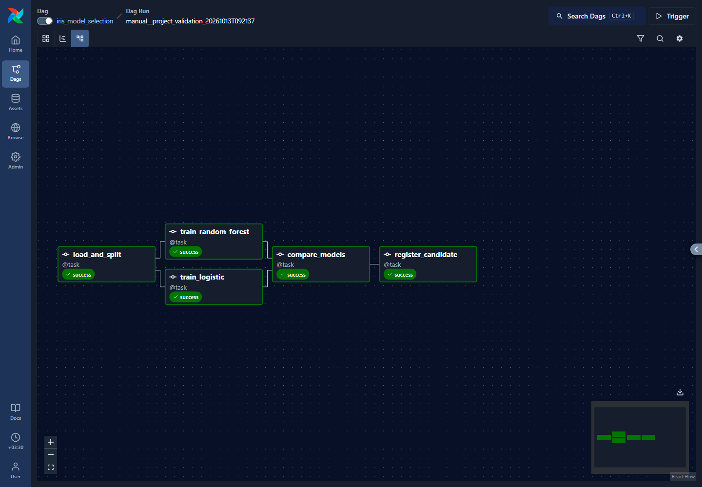
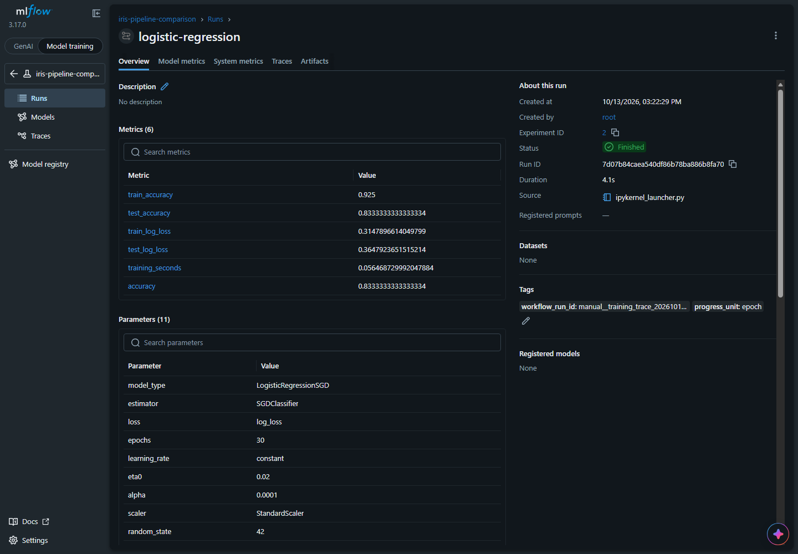
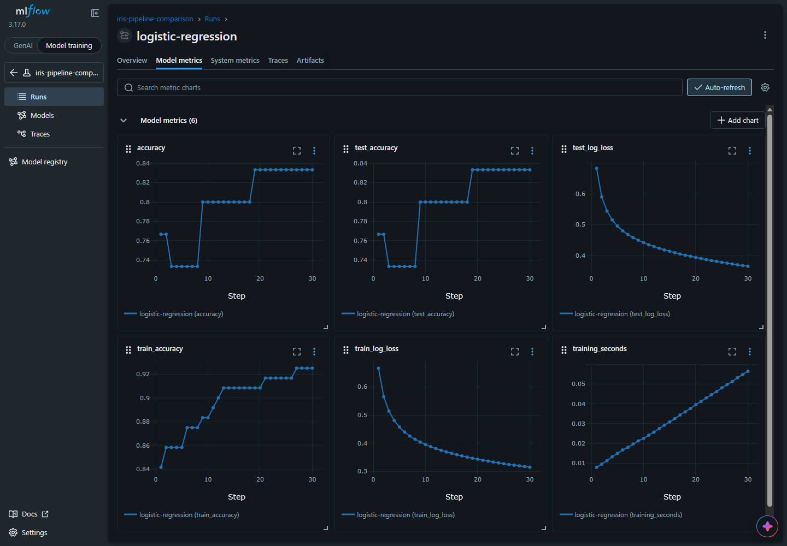
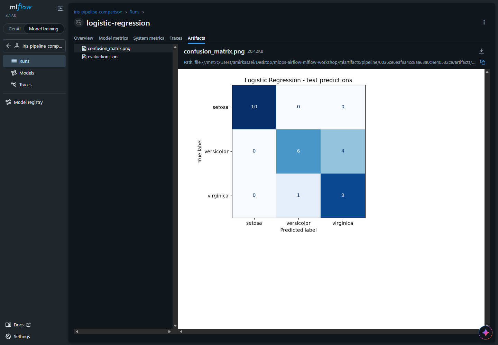
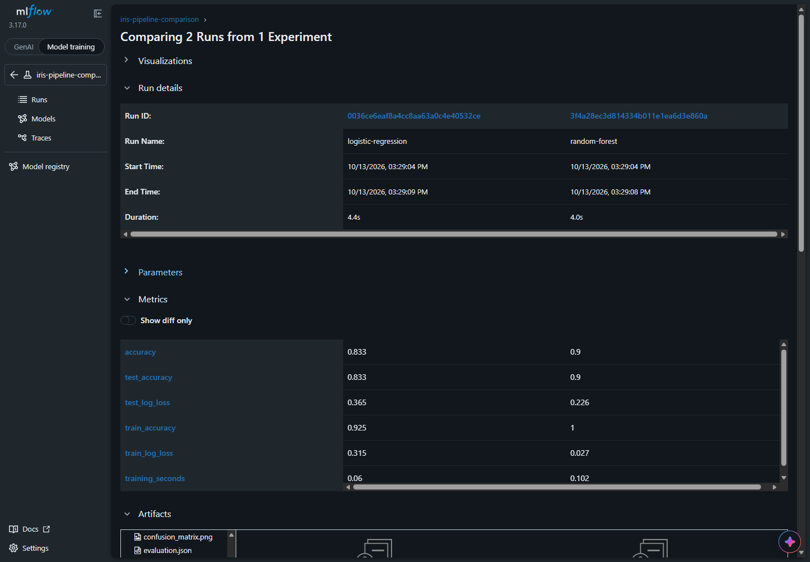
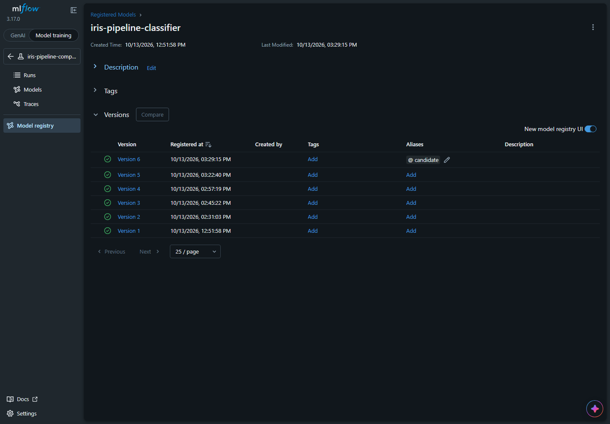
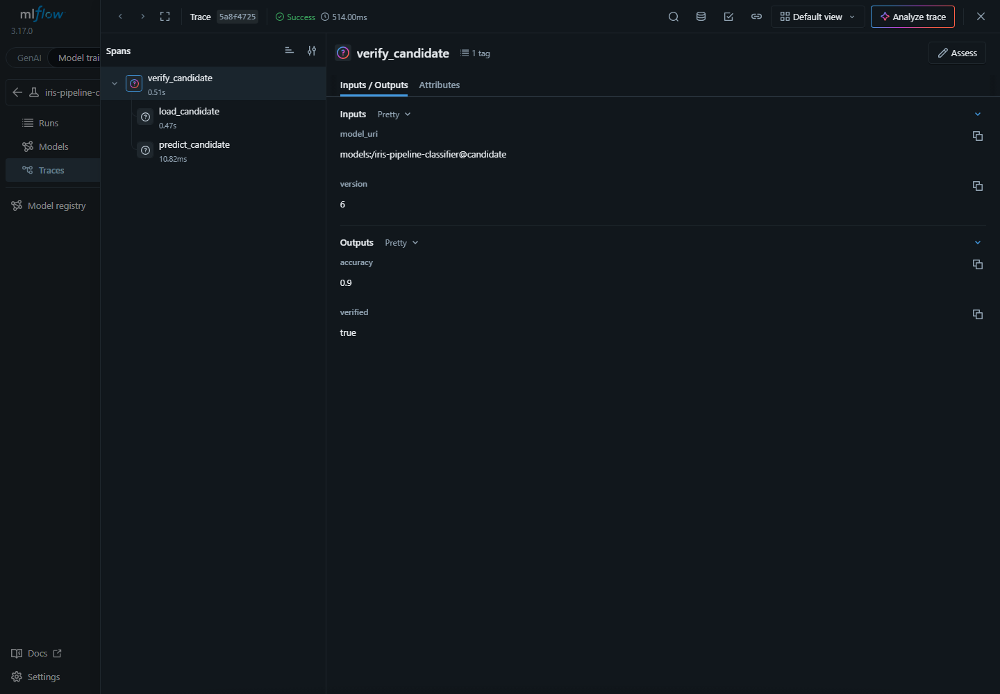

# Workshop: Airflow and MLflow

A teaching sequence for screen sharing. Open this file in VS Code Markdown Preview: **Ctrl+Shift+V** on Windows/Linux or **Cmd+Shift+V** on macOS.

Follow the sections in order: **problem -> Airflow demos -> main workflow -> MLflow results**. Each section gives the explanation, a code link, and something to show students. The linked walkthroughs contain the deeper code explanations for your preparation.

[Airflow UI](http://localhost:8080) | [MLflow UI](http://localhost:5000) | [Code walkthroughs](09-code-walkthrough.md)

---

## 1. The problem we will solve

We want to compare two ways of classifying Iris flowers: Logistic Regression and Random Forest.

Running notebooks by hand makes it easy to use different data, forget settings, lose results, or select a model without knowing which training attempt produced it.

We need a repeatable sequence and a record of what happened.

| Tool | Responsibility |
| --- | --- |
| **Airflow** | Run the steps in the correct order and show their progress, failures, and retries. |
| **MLflow** | Record training settings and results, compare attempts, and identify the selected model. |
| **Scikit-learn** | Train the models and make predictions. |

**Ask students:** if a model has good accuracy, what else would you need to reproduce that result?

---

## 2. First understand an Airflow task and DAG

A **task** is one unit of work. A **DAG** defines those tasks and their dependencies. A **DAG run** is one execution of that workflow; each task has its own execution state inside it.

The Python file defines what should happen. Airflow schedules and executes the defined work.

**Open code:** [success.py](../dags/demos/success.py). Point at `@dag`, `@task`, and the dependency:

```python
first_task() >> second_task()
```

`>>` means that the second task waits for the first to succeed.

**Show in Airflow:** open [demo_01_success](http://localhost:8080/dags/demo_01_success), trigger it, and select the new run. Open **Graph** to see the dependency. Select each task and open **Logs** to see what its Python function printed.


Preparation: [success code explanation](code-walkthrough/01-success.md).

---

## 3. What happens when work fails?

An exception escaping the task causes Airflow to mark that attempt failed. With no retry configured, dependent tasks cannot continue successfully.

**Open code:** [failure.py](../dags/demos/failure.py). Find the deliberately raised exception.

**Show in Airflow:** trigger [demo_02_failure](http://localhost:8080/dags/demo_02_failure). Select the failed task and open **Logs** to find the error. In Graph, inspect the dependent task's **Upstream failed** state.

Then open [retry.py](../dags/demos/retry.py):

```python
@task(retries=1, retry_delay=timedelta(seconds=5))
```

One retry permits two attempts in total. Our demo deliberately fails on attempt 1 and succeeds on attempt 2.

**Show in Airflow:** trigger [demo_03_retry](http://localhost:8080/dags/demo_03_retry). Inspect the two attempts in Logs and show that the final dependent task runs after recovery. The five-second delay makes the retry eligible; scheduling may take longer.

**Ask students:** how would you tell a recovered temporary failure from a task that never failed?

Preparation: [failure](code-walkthrough/02-failure.md) and [retry](code-walkthrough/03-retry.md). [Screenshots and click instructions](04-airflow-demo.md#2-failure-and-blocked-work).

---

## 4. Parallel work, inputs, and scheduling

Use these three small examples before opening the main project. Demonstrate each separately.

| Concept | Open code | Show in Airflow |
| --- | --- | --- |
| Independent tasks can overlap | [parallel.py](../dags/demos/parallel.py) | Trigger [demo_04_parallel](http://localhost:8080/dags/demo_04_parallel). Inspect Graph and Gantt: two branches, then a join. Available execution slots affect actual overlap. |
| A run can receive inputs | [parameters.py](../dags/demos/parameters.py) | Trigger [demo_05_parameters](http://localhost:8080/dags/demo_05_parameters), enter a student name, and find the greeting in Logs. |
| Airflow can create runs automatically | [scheduled.py](../dags/demos/scheduled.py) | Unpause [demo_06_scheduled](http://localhost:8080/dags/demo_06_scheduled). Observe scheduled runs for its 20-second intervals, then pause it again. |

For the scheduling example, unpausing enables the scheduler; a manual trigger is unnecessary.

Preparation: [parallel](code-walkthrough/04-parallel.md), [parameters](code-walkthrough/05-parameters.md), and [scheduling](code-walkthrough/06-scheduling.md). [Demo screenshots](04-airflow-demo.md).

---

## 5. Apply those ideas to our model workflow

```text
                    load_and_split
                          |
              +-----------+-----------+
              |                       |
        train_logistic        train_random_forest
              |                       |
              +-----------+-----------+
                          |
                    compare_models
                          |
                  register_candidate
```

Both models use one shared split: 120 training rows and 30 test rows. Their training tasks can run independently. Comparison waits for both; registration waits for the comparison.

**Open code:** [iris_model_selection.py](../dags/project/iris_model_selection.py). Show the task names and these dependencies:

```python
load_and_split >> [train_logistic, train_random_forest]
[train_logistic, train_random_forest] >> compare_models >> register_candidate
```

**Show in Airflow:** open [iris_model_selection](http://localhost:8080/dags/iris_model_selection), then Graph. Match each arrow to the code. This DAG uses `schedule=None`, so we trigger it manually.



Preparation: [main DAG explanation](code-walkthrough/07-main-dag.md).

---

## 6. Where the actual code runs

The DAG's runner uses Papermill to execute one notebook per task. Airflow monitors that notebook execution: it succeeds if the runner finishes successfully and fails if an execution error escapes.

| Task | Notebook containing its code |
| --- | --- |
| load_and_split | [01_load_and_split.ipynb](../notebooks/01_load_and_split.ipynb) |
| train_logistic | [02_train_logistic.ipynb](../notebooks/02_train_logistic.ipynb) |
| train_random_forest | [03_train_random_forest.ipynb](../notebooks/03_train_random_forest.ipynb) |
| compare_models | [04_compare_models.ipynb](../notebooks/04_compare_models.ipynb) |
| register_candidate | [05_register_candidate.ipynb](../notebooks/05_register_candidate.ipynb) |

Each notebook runs in a separate Python session. They share data and model references through JSON files in `outputs/<run-folder>/`. The DAG supplies the same workflow ID and output folder to all five.

**Open code:** the `pm.execute_notebook(...)` call in [the DAG](../dags/project/iris_model_selection.py), then the parameters cell in [notebook 01](../notebooks/01_load_and_split.ipynb). Show how the supplied paths reach the notebook.

**Show in Airflow:** trigger the main DAG once and select that run. Open **load_and_split > Logs**, then the training tasks' Logs. Point out the notebook name, printed progress, and saved executed copy.

Iris runs quickly. Use this completed run for the following demonstrations if you miss the Running state. Running notebook cells directly in VS Code can log to MLflow, but it does not create an Airflow task execution.

Preparation: [notebook runner](code-walkthrough/07-main-dag.md) and [shared data](code-walkthrough/08-load-and-split.md).

---

## 7. Find the training records in MLflow

One Airflow workflow execution creates **two MLflow training runs** in the `iris-pipeline-comparison` experiment.

| Term | Example in this workshop |
| --- | --- |
| Experiment | The grouping `iris-pipeline-comparison`. |
| Run | One `logistic-regression` or `random-forest` training attempt. |
| Parameter | A fixed setting, such as 30 epochs or 100 trees. |
| Metric | A measured number, such as test accuracy or log loss. |
| Tag | A label, such as `workflow_run_id`, linking records to their workflow execution. |
| Artifact | A saved output file, such as an evaluation JSON or confusion matrix. |

**Open code:** [notebook 02](../notebooks/02_train_logistic.ipynb). Show `start_run`, `log_params`, and `set_tag`. These calls open the training record and attach the settings and workflow label.

**Show in MLflow:** [Experiments](http://localhost:5000/#/experiments) > **iris-pipeline-comparison > Runs**. Open `logistic-regression` from the workflow you just triggered. In **Overview**, inspect parameters, latest metrics, and the `workflow_run_id` tag. Match it to the selected Airflow run.



Preparation: [connection and experiment commands](code-walkthrough/08-load-and-split.md) and [run logging commands](code-walkthrough/09-train-logistic.md).

---

## 8. Watch how training measurements become curves

Our logistic classifier learns for 30 epochs using `partial_fit`. The forest adds ten trees per checkpoint until it reaches 100. After each update, Python calculates accuracy, log loss, and accumulated fitting time.

**Open code:** the training loop in [notebook 02](../notebooks/02_train_logistic.ipynb). Find:

```python
mlflow.log_metrics(metrics, step=step, synchronous=True)
```

`metrics` contains the measured numbers; `step` identifies the checkpoint. Repeating this call with increasing steps saves numeric histories. MLflow records the values we calculate; the scikit-learn calls do the training.

- **Accuracy:** fraction of correct predictions; higher is better.
- **Log loss:** probability-based prediction error; lower is better.
- **Training seconds:** accumulated fitting time.

**Show in MLflow:** open the training run's **Model metrics**. Inspect train/test accuracy and loss curves. Logistic steps mean epochs; forest steps mean total trees. Compare their final scores rather than equal step numbers.



**Show in Airflow:** open **train_logistic > Logs** to see the same checkpoints printed as text. This is workflow logging; MLflow provides the stored metric curves.

Preparation: [metric logging](code-walkthrough/09-train-logistic.md#understand-each-metric-checkpoint) and [forest checkpoints](code-walkthrough/10-train-forest.md).

---

## 9. Save evidence and a reusable model

We save final scores as `evaluation.json`, test mistakes as `confusion_matrix.png`, and the fitted model so it can be reloaded later.

**Open code:** [notebook 02](../notebooks/02_train_logistic.ipynb). Show `log_dict`, `log_figure`, and the model-saving call:

```python
model_info = mlflow.sklearn.log_model(
    sk_model=model,
    name="model",
    signature=infer_signature(X_test, predictions),
    input_example=X_train.head(3),
)
```

This saves the fitted pipeline, including its scaler. The signature describes expected inputs and outputs; the example shows sample input rows. `model_info.model_uri` identifies the saved model for registration later.

**Show in MLflow:** run **Artifacts > confusion_matrix.png**, then `evaluation.json`. The confusion matrix's diagonal counts correct predictions; the other cells count mistakes.



Then open **Overview > Logged models > model**. Inspect its source run and saved files. If the model page says **No metrics recorded**, follow its source run to **Model metrics**: we attached the measurements to the training run.

Preparation: [artifact and model-saving commands](code-walkthrough/09-train-logistic.md#save-files-and-the-fitted-model).

---

## 10. Compare the two approaches

Both training tasks finishing successfully tells us that their code completed. We still need to decide which model performed better.

**Open code:** [notebook 04](../notebooks/04_compare_models.ipynb). Show `client.get_run(...)`, which retrieves each attempt's saved record, then:

```python
ranked_runs = client.search_runs(
    experiment_ids=[logistic_run.info.experiment_id],
    filter_string=run_filter,
    order_by=["metrics.test_accuracy DESC", "params.model_type ASC"],
    max_results=1,
)
best_run = ranked_runs[0]
```

MLflow's built-in search ranks the runs by **final test accuracy** and returns the top result. `run_filter` limits the query to this execution's two completed training run IDs, excluding older attempts. Sorting `model_type` ascending breaks ties in favor of Logistic Regression. `winner.json` keeps the selected model URI and source run ID for the next task.

**Show in MLflow:** return to the experiment's **Runs** list. Select the two runs with the same `workflow_run_id` and click **Compare**. Show the final test accuracy, loss, and training duration.



Read the live values rather than assuming the screenshot's results. MLflow provides the comparison UI and ranking API; we supply the metric, eligible runs, and tie-break rule. Registration and assigning `candidate` are explicit steps in the next notebook, not automatic effects of logging.

Preparation: [comparison and get_run](code-walkthrough/11-compare-models.md).

---

## 11. Give the selected model a version and alias

A logged model is saved training output. Registering it creates a numbered version under a stable model name. The `candidate` alias points to the version selected by this workflow.

**Open code:** [notebook 05](../notebooks/05_register_candidate.ipynb):

```python
model_version = mlflow.register_model(winner["model_uri"], registered_model_name)
client.set_registered_model_alias(
    name=registered_model_name,
    alias="candidate",
    version=model_version.version,
)
```

Later executions can create new versions and move `candidate`, while older versions remain identifiable. This step manages the saved model; it does not deploy it.

**Show in MLflow:** open [iris-pipeline-classifier in Model registry](http://localhost:5000/#/models/iris-pipeline-classifier). Find **candidate**, open that version, and follow its source run back to the winning training attempt.



Preparation: [registration and alias commands](code-walkthrough/12-register-candidate.md#understand-registration-and-the-alias).

---

## 12. Verify the candidate and follow the whole execution

The final notebook loads `models:/iris-pipeline-classifier@candidate`, predicts on the same test rows, and checks that its source run and accuracy match the selected winner.

**Open code:** [notebook 05](../notebooks/05_register_candidate.ipynb). Show `load_model`, the `assert` checks, and the `start_span` blocks.

A **trace** records the verification operation. Its **spans** record the timed parts:

```text
verify_candidate
|-- load_candidate
`-- predict_candidate
```

**Show in MLflow:** experiment **iris-pipeline-comparison > Traces**. Open the current verification trace. Inspect status and duration, then **predict_candidate > Inputs / Outputs** for actual test rows and predictions.



**Finish by following one execution:** Airflow task states -> matching MLflow training runs -> comparison -> candidate version -> verification trace. The shared workflow tag and source run IDs connect these records.

**Ask students:** if `candidate` moves tomorrow, which record would identify the version selected today?

Preparation: [tracing commands](code-walkthrough/12-register-candidate.md#understand-the-tracing-commands) and [trace UI details](07-model-registry.md).

---

<details>
<summary>Instructor preparation - before screen sharing</summary>

Complete [Python setup](01-python-setup.md), [Airflow setup](02-airflow-setup.md), [MLflow setup](05-mlflow-setup.md), and the [notebook execution environment](08-main-project.md#prepare-the-execution-environment) before the lesson.

- Have Airflow and MLflow running, with their browser tabs open. Use existing running services if available.
- Log in to Airflow before presenting. Open the demo DAGs and the main DAG.
- Keep a completed main workflow run available; Iris can finish before students see the running states.
- Open source files beside this preview. Use the [per-file walkthroughs](09-code-walkthrough.md) for your own code preparation.
- Keep the scheduling demo paused until section 4, and pause it again afterward.
- Use one workflow execution consistently when showing training runs, comparisons, versions, and traces.

Screenshots show real earlier executions. Their IDs, version numbers, and scores can differ from the current UI. Local UI links work when the services are running on your computer.

</details>
